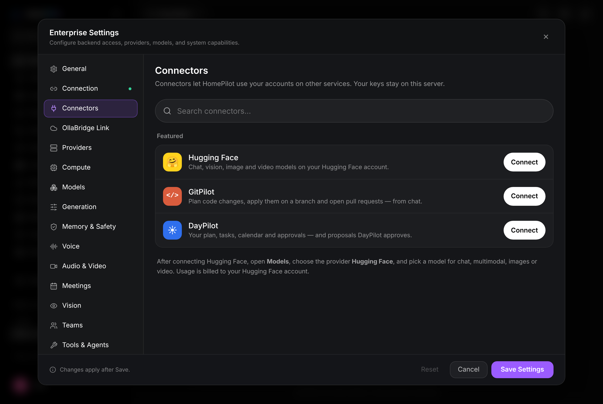
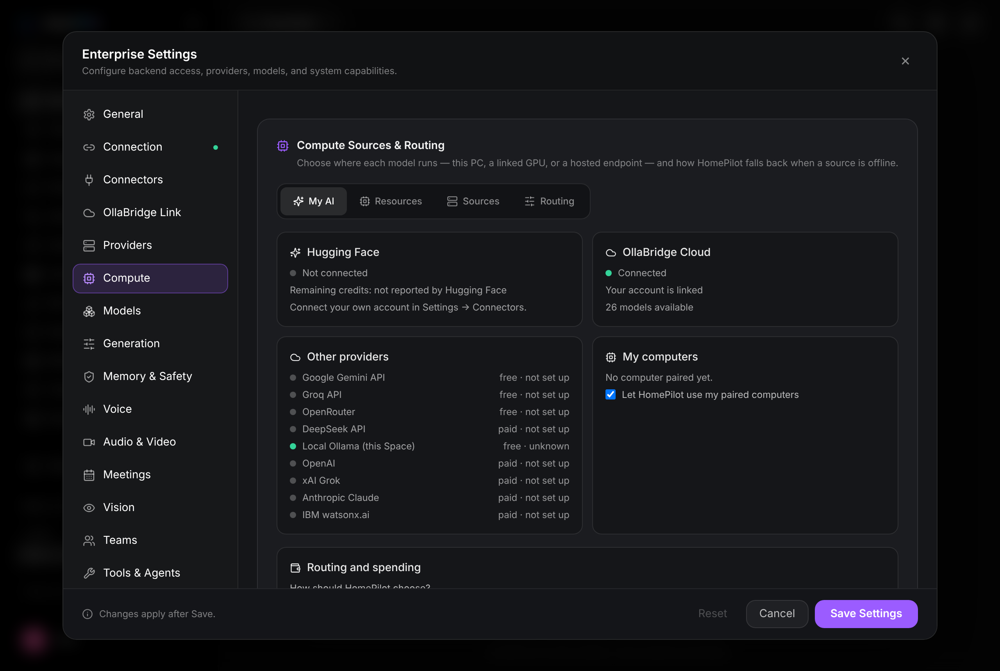
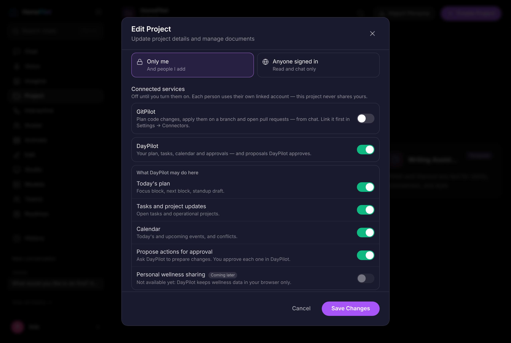
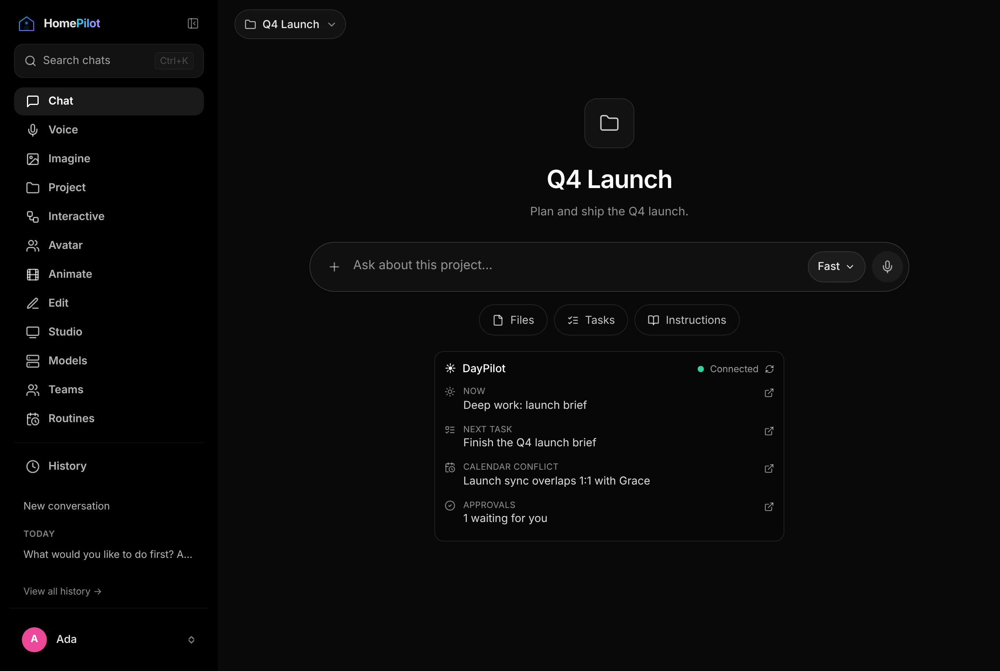

# HomePilot One — status

Last reviewed: 13 November 2026. Nothing below is merged or deployed.

## Pull requests (a stack; review bottom-up)

| Repo | Branch | PR | Contents |
|---|---|---|---|
| HomePilot | `claude/sharp-hypatia-nuervm` | #192 | HF-first routing, My AI, spending protection, HF connector, durable `/data` |
| HomePilot | `feat/homepilot-unified-project-connectors` | #193 (draft) | Project isolation, per-project permissions, encrypted connector store, GitPilot connector |
| HomePilot | `feat/daypilot-connector` | #194 (draft) | DayPilot connector, workday card, governed proposals |
| ollabridge-cloud | `claude/sharp-hypatia-nuervm` | #64 | Signed routing policy, tiers, provenance, streaming failover, catalog, HF media jobs |
| DayPilot | `feat/homepilot-connector-contract` | #30 (draft) | Pairing (device code + PKCE), scoped grants, manifest v1, proposals, consent page |

## Verified

* Unit and integration tests in each repo (OllaBridge 804 passing; HomePilot and
  DayPilot connector suites passing).
* A real-browser walk-through of HomePilot, OllaBridge and DayPilot running
  together: connector catalog, DayPilot pairing and consent, project
  permissions, workday card, connections management.

## Not yet verified

* A real Hugging Face completion: the token supplied for testing lacked the
  "Make calls to Inference Providers" permission (HTTP 403).
* A live GitPilot server (a stand-in following its REST contract was used).
* DayPilot behind a public URL; production deployment of any component.

## Known pre-existing failures (not from this work)

HomePilot backend: 19 (missing boto3/langgraph, network, order-dependent voice
tests). Frontend: 2 MeetingSense tests. DayPilot: presentations tests.

## Decisions needed

1. Owner for legacy projects created before isolation (default: first admin).
2. Production value of `HOMEPILOT_CONNECTOR_SECRET_KEYS` and its rotation.
3. The rest of the Unified Projects spec from section 5 (GitPilot / SelfRepair
   service-to-service work is on hold until then).
4. Merge order and approval for the PR stack above.
