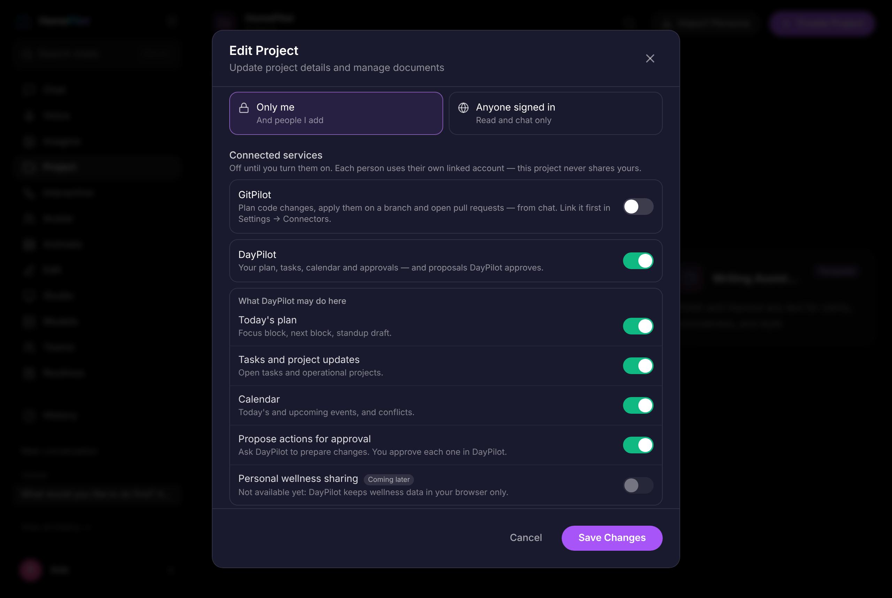

# Projects as a permission boundary

HomePilot One makes each project the unit of access and of capability: who
can open it, what they can change, and which tools and services may act
inside it. This document describes what is enforced, where, and how existing
installations are migrated.

## Before this change

* Project metadata was one shared JSON file (`projects_metadata.json`).
* `require_api_key`, used on most project routes, is a no-op shim; most
  project routes did not check the caller. Any signed-in user could read,
  edit, export or delete any project by id. Only default assistants were
  filtered, and only from the list.
* Connector tokens were stored in plaintext in SQLite.

## Model

| Concept | Meaning |
|---|---|
| Owner | Exactly one user. Full control: delete, sharing, permissions. |
| Member | A user added by the owner as `viewer` (read, chat) or `editor` (change content and files). |
| Workspace | An organisation. Members get their workspace role on projects shared with the workspace, capped at `editor`. |
| Visibility | `private` (default), `workspace`, or `public` (read and chat only for everyone else). |

Ownership and membership live in SQLite (`project_acl`, `project_members`,
`workspaces`, `workspace_members`). Access is decided only from these
tables — never from fields a client sends. Project content stays in the JSON
file, which is now written atomically (write, fsync, rename).

## Enforcement

`ProjectGuard` (`backend/app/project_access.py`) is an ASGI middleware that
runs before every route:

| Request | Check |
|---|---|
| `/projects/{id}/…`, `/v1/inventory/{id}/…` | read for GET; `editor` for changes; `owner` for `DELETE /projects/{id}`, `…/capabilities`, `…/members`, `…/sharing` |
| `?project_id=` on any route | read (or `editor` on persona memory and view-pack changes) |
| `project_id` or `personalityId: "persona:<id>"` in a JSON body | the same — covers `/chat`, `/v1/agent/chat`, persona sessions and memory |

Because it matches paths rather than individual handlers, routes added later
under `/projects/{id}` are covered automatically. A project the caller cannot
see answers **404**, exactly like one that does not exist, so ids cannot be
probed. `GET /projects` lists only projects the caller may see.

On a single-user install with no session, the install's one account is the
caller, as it already is for conversations — local installs keep working
without signing in.

Not covered by this change: the separate Studio "video projects"
(`/studio/projects`), the OpenAI-compatible persona API (protected by its own
API key, by design shared), and `/files/{asset}` (already owner-scoped).

## Tool and connector permissions

`backend/app/project_capabilities.py`:

* **Built-in agent tools** are on unless the project turns them off — existing
  projects behave as before.
* **Connectors** (GitPilot today) are **off until the owner turns them on**.
* The check runs inside the agent loop before any tool executes. The model's
  tool list is filtered too, but that is only a hint: a model that names a
  disabled tool gets a refusal and the attempt is logged as `tool.denied`.
* A GitPilot approval created inside a project stops working if the project
  turns GitPilot off, or the user loses access, before it is approved.
* A project never carries credentials. In a shared or public project,
  connector tools run with the *caller's own* linked account, or not at all.

## Activity

Every project has an append-only log (`project_activity`): creation,
migration, sharing and membership changes, capability changes, each tool
invocation and refusal, and coding approvals. `GET /projects/{id}/activity`
(editor or owner).

## API

| Route | Role |
|---|---|
| `GET /projects/{id}/sharing` | viewer (members list: owner only) |
| `PUT /projects/{id}/sharing` | owner |
| `PUT` / `DELETE /projects/{id}/members/{user}` | owner |
| `GET /projects/{id}/capabilities` | viewer |
| `PUT /projects/{id}/capabilities` | owner |
| `GET /projects/{id}/activity` | editor |
| `POST /v1/workspaces`, `PUT /v1/workspaces/{id}/members/{user}` | signed in / workspace owner |

The UI is in **Edit Project → Permissions**.

## Migration of existing projects

Runs once, automatically, on the first access check after upgrading.

* Ids and content are not changed. `projects_metadata.json` is copied to
  `projects_metadata.pre-acl.json` before the first migration.
* A project that already names its owner (default assistants) keeps it.
* Every other project is owned by `HOMEPILOT_LEGACY_PROJECT_OWNER` (a user id
  or username) if set, otherwise by the install's **first** non-guest account.
  On a multi-user install, set this variable before upgrading if the first
  account is not the right owner; ownership can be shared afterwards with
  members or a workspace.
* `is_public: true` becomes `visibility: public`.
* It is idempotent and logged (`acl.migrated`).

**Rollback:** stop the app and drop `project_acl`, `project_members`,
`workspaces`, `workspace_members`, `project_activity` and
`project_capabilities`. The previous version reads only the JSON file, which
the migration does not modify.

## Connector secrets

`backend/app/connectors/store.py` encrypts every secret at rest
(Fernet, `enc:v1:` prefix).

| Setting | |
|---|---|
| `HOMEPILOT_CONNECTOR_SECRET_KEYS` | Comma-separated Fernet keys. The first encrypts; all decrypt. **Set this from a secret store in production.** |
| (unset) | A key is generated once in `connector_secret.key` beside the database (mode 600). Protects copies of the database without the key; `/compute/readiness` warns. |

Generate a key:

```bash
python -c "from cryptography.fernet import Fernet; print(Fernet.generate_key().decode())"
```

Rotate: put the new key first, keep the old one after it, restart, then run
from `backend/`:

```bash
python -m app.connectors.store rotate
```

Then remove the old key. Plaintext rows from earlier versions are encrypted
the first time the store opens. A row no configured key can decrypt reads as
"not linked", so the user reconnects instead of a broken credential being
sent. No API response or log line contains a secret.

## Tests

`backend/tests/test_project_isolation.py` — cross-user access on every
project route family, path, query and body checks, roles, public and
workspace sharing, migration (ids and content preserved, idempotent),
rollback, template ownership, capability defaults and enforcement against a
model-issued tool call, approvals after a project turns GitPilot off,
credentials never lent through a shared project, and secret encryption,
legacy re-encryption, rotation and lost keys.

## What it looks like



Visibility, connected services (off until turned on; each person uses their own
linked account) and assistant tools, set per project by its owner.
