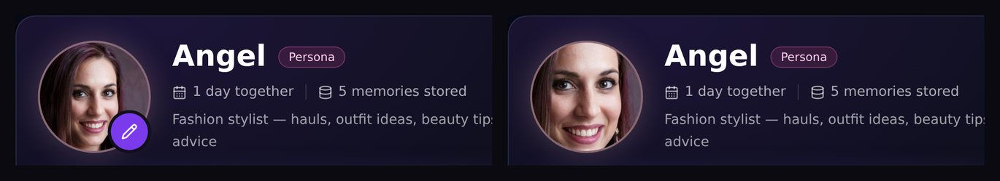
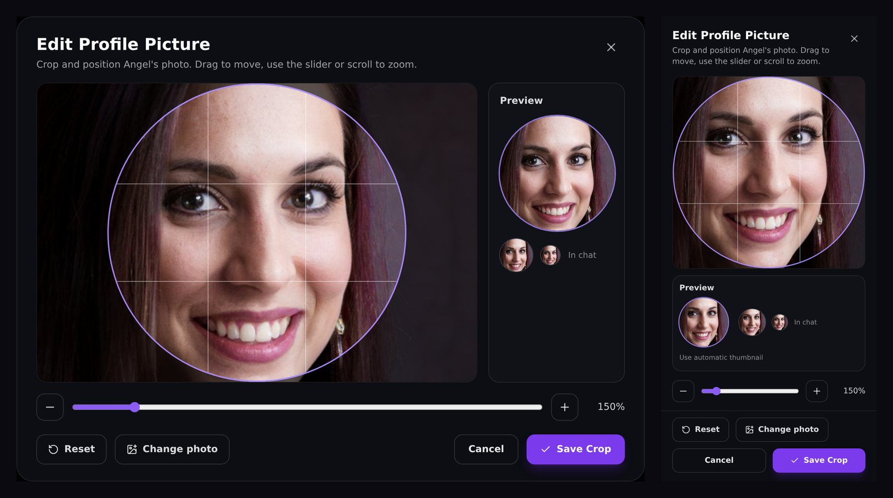

# Edit Profile Picture

Frame a persona's picture yourself: what you choose becomes the round avatar
everywhere — the Conversation Hub, the chat header, beside replies, Voice and
the project card. The original picture is never changed, and the framing is
kept, so you can reopen the editor later and refine it.





## Using it

1. Open a persona. In its Conversation Hub, click the picture (or the pencil at
   its corner — it appears on hover with a mouse, and is always shown on touch
   screens).
2. **Edit Profile Picture** opens on the persona's current, full-resolution
   picture — nothing to upload. It opens at the framing you saved last time, or
   centred at 100% the first time.
3. Move the picture by dragging it (or, with the crop area focused, the arrow
   keys). Zoom with the slider, the − / + buttons, the mouse wheel or a pinch.
   The circle shows what the avatar keeps; **Preview** shows exactly that at the
   sizes it is used, large and in chat.
4. **Save Crop**. The new avatar appears at once in the hub and the chat.

Other actions:

| Action | What it does |
|---|---|
| **Reset** | Back to the whole picture, centred, at 100% |
| **Change photo** | Pick a PNG, JPEG or WebP (up to 25 MB) and frame it. It only replaces the persona's picture when you save; the previous picture is kept in the persona's picture history |
| **Use automatic thumbnail** | Shown when a framing is in use: go back to the thumbnail HomePilot made. The framing is remembered, so the editor still reopens there |
| **Cancel** | Close without changing anything |

Closing any other way — the ×, the backdrop or Escape — asks *Discard your
changes to the picture?* first when there is something unsaved (Escape again
keeps editing). If saving fails, the editor stays open with your framing and
says why.

Keyboard: focus starts on the crop area; Tab and Shift+Tab stay inside the
editor; Escape is handled by the editor, never by the hub underneath.

## How it works

The browser only chooses the framing; the picture is cut on the server, from
the original file at full resolution.

```
POST /projects/{id}/persona/avatar/crop     multipart form
  area   JSON {x, y, width, height} — the square to keep, in % of the picture
  zoom   the editor's zoom (stored so the editor reopens the same way)
  file   optional replacement photo
DELETE /projects/{id}/persona/avatar/crop   back to the automatic thumbnail
```

- The original is opened with its EXIF orientation applied (as the browser
  shows it), the area is turned into a square inside the picture — never
  stretched — and resized to **512 × 512** WebP:
  `thumb_<picture>_crop_<id>.webp`, next to the picture.
- That file becomes the persona's `selected_thumb_filename`, which every round
  avatar already uses, so nothing else had to change to show it.
- The framing is stored in `persona_appearance.avatar_crop`: the source
  picture, area, zoom, output, and the automatic thumbnail it replaced (used by
  DELETE). A framing only counts while its output is still the persona's
  thumbnail — choosing another look elsewhere replaces it, and the editor then
  opens centred on the new picture.
- A replacement photo is checked (PNG, JPEG or WebP, readable, at most 50
  megapixels, the upload size limit), stored like any other avatar commit, and
  the previous picture goes to `avatar_history`. The original files stay on disk.
- Everything is saved on the project, so it holds after a reload and on any
  device signed in to the same HomePilot.
- It stays until you pick another look. Saving Persona Settings — even from a
  panel opened before the crop — keeps it: the project save restores the
  framed picture when a client sends back an older copy of the appearance (or
  wraps the current picture in a look of its own), and the automatic avatar
  re-commit that follows a settings save leaves a framed picture alone.
  Choosing a different look replaces the framing, as before.

The face zoom in **Settings → Chat** (*Zoom pictures to the face*, off by
default) never overrides a framing you saved.

Code: `frontend/src/ui/components/AvatarCropEditor.tsx` (the editor, built on
[react-easy-crop](https://github.com/ValentinH/react-easy-crop)),
`frontend/src/ui/avatarCrop.ts` (saving, preview, which framing is in use),
`frontend/src/ui/sessions/SessionPanel.tsx` (the pencil),
`backend/app/personas/avatar_crop.py` and the two routes in `backend/app/main.py`.
Tests: `frontend/src/test/avatarCrop.test.tsx`,
`frontend/src/test/conversationHub.test.tsx`, `backend/tests/test_avatar_crop.py`.
