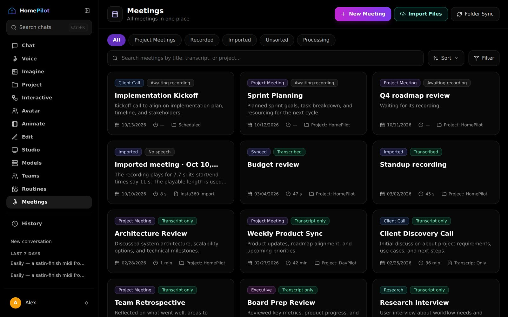
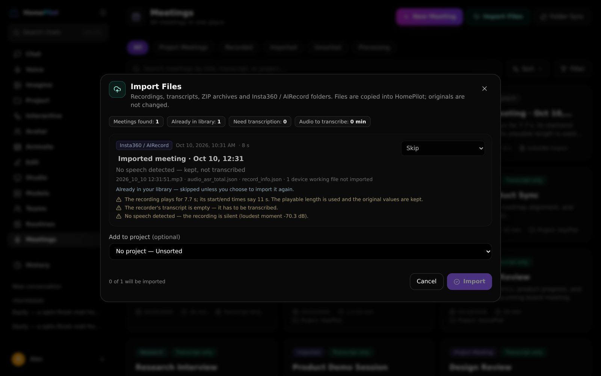
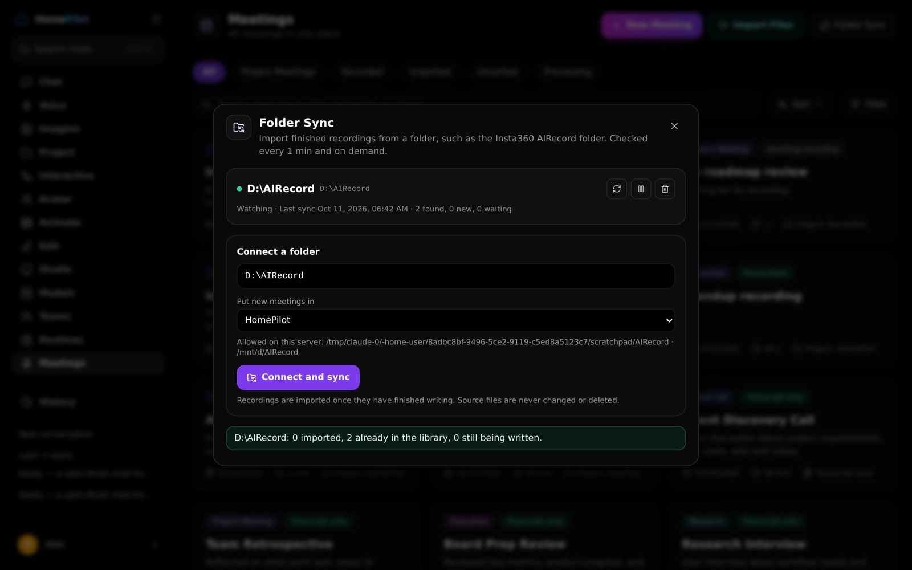
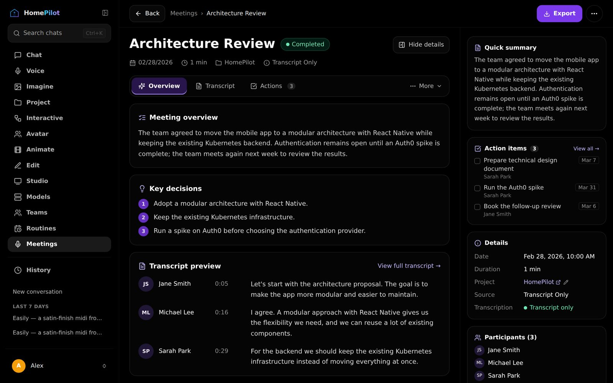
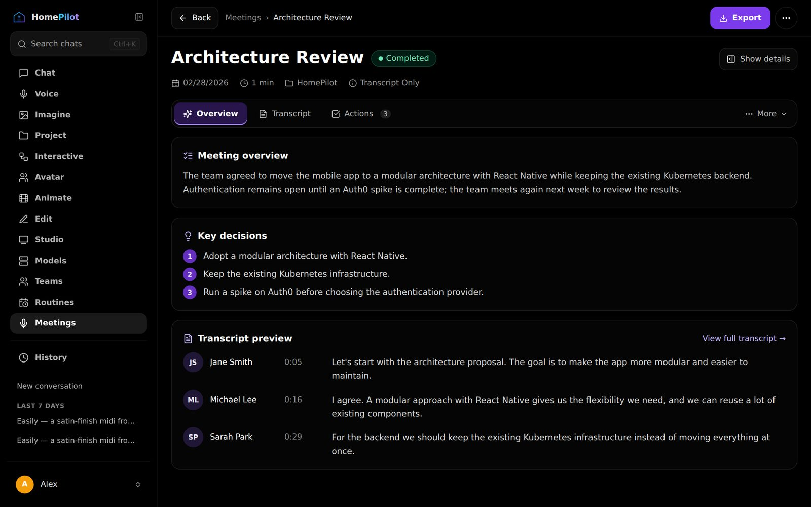
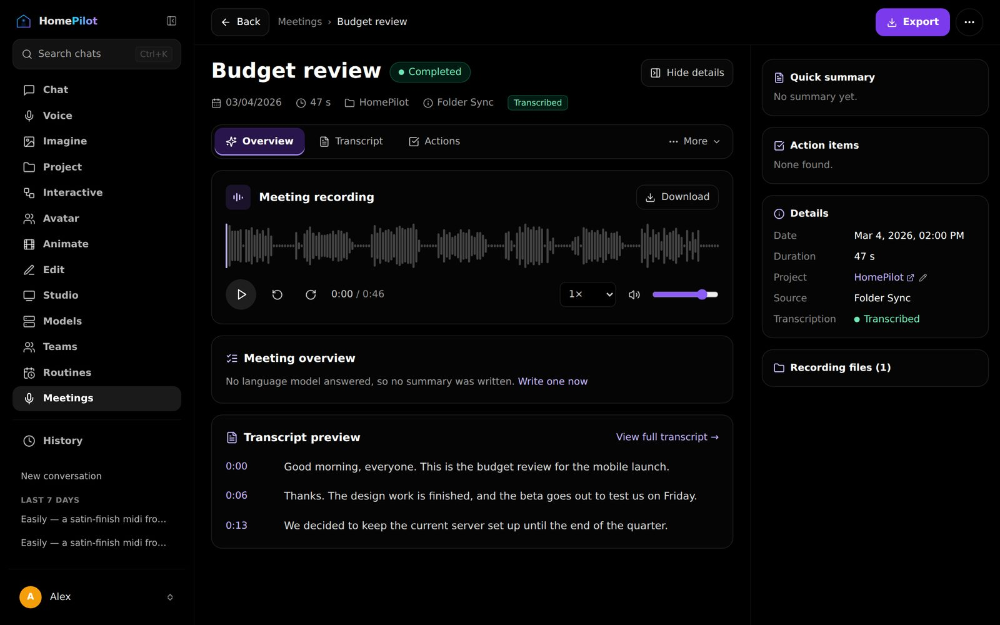
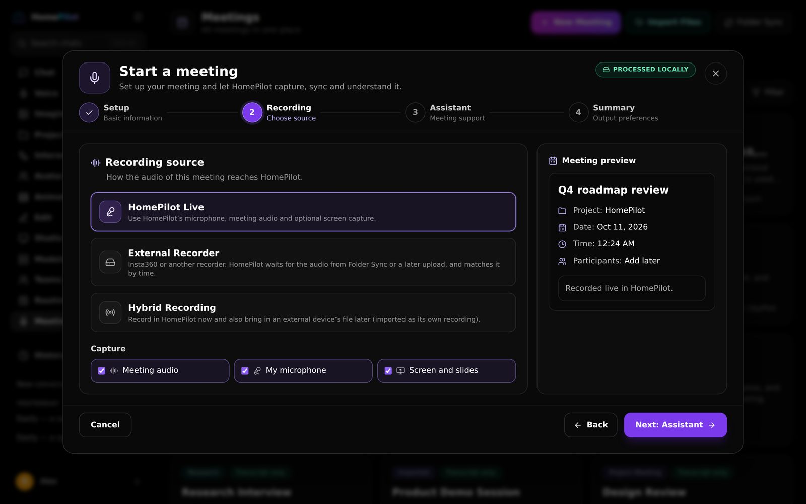
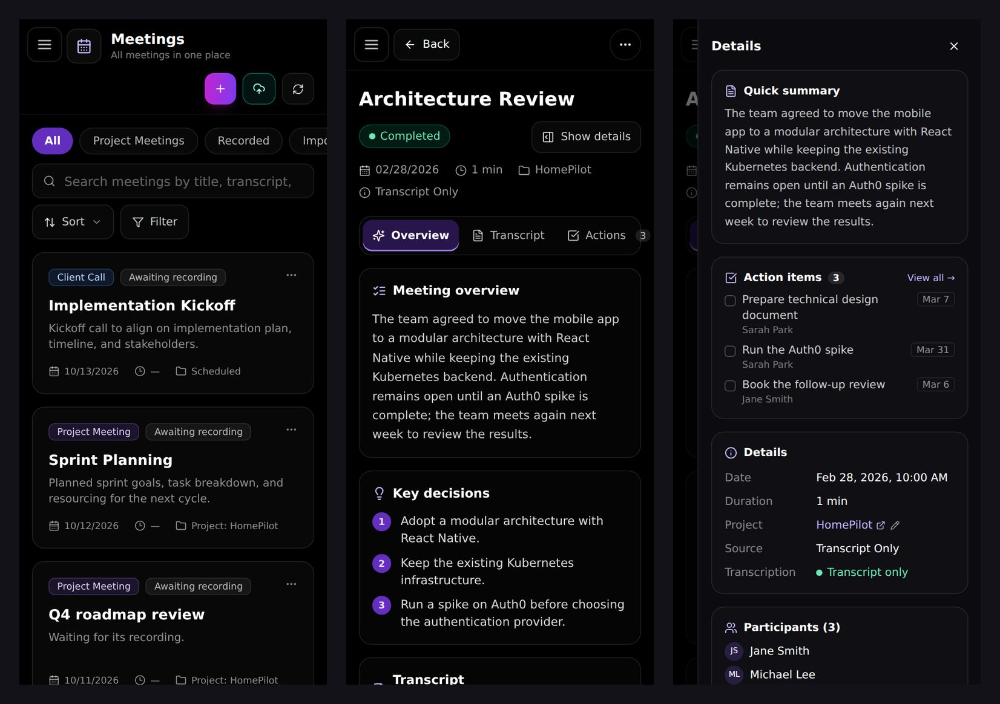

# Meetings Library

One place for every meeting: the ones HomePilot recorded live, project meetings,
recordings imported from an Insta360 / AIRecord device, audio files you upload,
transcripts with no audio, scheduled meetings still waiting for their recording, and
Teams rooms. It lives in the existing **Meetings** section and looks like **Projects**.

It is **additive and off by default**. With the flag unset, the Meetings section,
its catalog and every existing MeetingSense endpoint behave exactly as before.



## Turning it on

| Setting | Default | What it does |
|---|---|---|
| `MEETINGS_LIBRARY_UPGRADE` | on | Shows the library in the Meetings section and enables its API. `0` hides it again; nothing is deleted. |
| `MEETINGS_INTELLIGENCE` | on | The typed analysis of each transcript and the Visual Summary (see *Meeting insights*). Needs the library. |
| `MEETINGS_LIBRARY_PROCESSING` | on | Background transcription, search indexing and summaries for imported recordings. |
| `MEETINGS_SYNC_ALLOWED_ROOTS` | empty | Folders the server may watch, separated by `;`. Empty means Folder Sync is off. |
| `MEETINGS_IMPORT_MAX_MB` | 2048 | Largest upload (per import). |
| `MEETINGS_STT_CHUNK_S` | 300 | Length of the audio pieces sent to the local speech model. |
| `MEETINGS_SYNC_INTERVAL_S` | 60 | How often a connected folder is checked. **Sync now** checks immediately. |
| `MEETINGS_SYNC_STABILITY_S` | 10 | A file must stop changing for this long before it is imported. |
| `MEETINGS_LIBRARY_DIR` | next to uploads | Where HomePilot keeps its own copies of imported files. |

```bash
# .env (HomePilot running in WSL, recorder files on D:\AIRecord)
MEETINGS_SYNC_ALLOWED_ROOTS=/mnt/d/AIRecord
```

Restart the backend. **Meetings** in the sidebar now opens the library.
`MEETINGSENSE_ENABLED` is not required for imports. Live recording still needs it.

## Importing

**Import Files** accepts:

| What | Files |
|---|---|
| Insta360 / AIRecord | A recording folder, or a ZIP of one (the folder with `.airecord_data/record_info.json`) |
| Audio | `.mp3 .m4a .wav .ogg .opus .flac .aac .webm .mp4` |
| Transcripts | `.srt .vtt .txt .md .json` (Whisper JSON, `segments`/`utterances` lists, AIRecord `audio_asr_total.json`) |
| Several at once | A ZIP with any of the above |

Nothing is imported until you confirm the **preview**. For each meeting the preview
shows what was found, what will be done with it (import as new, attach to a scheduled
meeting, or skip), and anything unusual:



What the importer does with an AIRecord folder (checked against a real export):

- **The recorder's transcript is read, not trusted.** An empty `Result_info` means
  *needs transcription*, never "Transcribed".
- **A silent recording says so.** The audio's loudness is measured; a recording that never
  rises above −55 dB is marked *No speech* and is not sent to the speech model.
- **Times that disagree are reported, not hidden.** In the sample, the audio plays for
  7.68 s, `duration` says 7000 ms and the start/end times are 11 s apart. The playable
  length is used, and the original values are kept under **Properties → Original recorder metadata**.
- **The recorder's own names are kept**, including the `∶` (U+2236) characters in
  `2026_10_10 12∶31∶51`. The card title becomes "Imported meeting · Oct 10, 12:31",
  and a placeholder description such as `xxxx会议描述` is dropped.
- **Device working files** (`.airecord_data/asr_audio_slice/…`, `dot.txt`) are listed as
  "not imported".
- **No duplicates.** A meeting is recognised by the recorder's `localMeetingId` and by the
  SHA-256 of its audio, so importing the same ZIP, the same folder again, or the same
  files through Folder Sync reports *Already in your library* instead of making a copy.
- **ZIPs are opened safely**: no paths outside the archive, no links, and limits on entry
  count, total size and compression ratio.

Files are **copied** into HomePilot. The originals are never modified, moved or deleted.

## Folder Sync

**Folder Sync** watches a folder and imports finished recordings by itself, for example
the Insta360 app's `D:\AIRecord`.



- **The server reads the folder**, not the browser. Typing a path grants nothing: the folder
  must be inside `MEETINGS_SYNC_ALLOWED_ROOTS`, and anything else is refused with a reason.
- **Windows paths work under WSL.** `D:\AIRecord` is read as `/mnt/d/AIRecord`.
- **Where HomePilot runs matters.** HomePilot in WSL or natively on the same Windows
  computer as the recorder can watch its folder. A HomePilot server elsewhere (another
  computer, a container without that drive mounted) cannot see `D:\`. Upload the files
  with **Import Files** instead.
- **Only finished files.** A file is imported once its size and modification time have
  stayed the same for `MEETINGS_SYNC_STABILITY_S`. Files still being written are counted as
  *waiting*.
- **Once.** A file already imported (same recorder id or same content) is skipped, also
  after a rename or a move within the folder.
- **Read-only.** HomePilot never writes to, renames or deletes anything in the folder. If an
  original disappears, the meeting keeps HomePilot's copy and shows "original no longer in the folder".
- **Pause** stops watching; **Disconnect** forgets the folder and keeps its meetings.
- A recording that starts within 45 minutes of exactly one **scheduled** meeting is attached
  to it. With several candidates, it is imported on its own and you choose in the preview.
- **Insta360 Wave**: the device shows its storage only in File Transfer mode, and WSL does not
  see removable drives, so a small Windows watcher copies finished recordings into an inbox
  that Folder Sync watches. See [insta360-wave.md](insta360-wave.md).

## Transcription and processing

Recordings are transcribed **on this computer** with the same local speech-to-text provider
MeetingSense uses (`get_meeting_stt_provider()`, local first, e.g. faster-whisper). Audio is
**never sent to a cloud service** by the library. If no local model is installed, the
recording is stored and marked *Needs setup*, with the install hint. **Retry** picks it up afterwards.

- Long recordings are decoded with FFmpeg in pieces (`MEETINGS_STT_CHUNK_S`) with a one-second
  overlap that is removed again, so a word on a boundary is neither lost nor doubled.
- While a live meeting is recording, imports wait, so the two never compete for the model.
- Each transcript is a **version**: imported, transcribed here, recorded live, or corrected by
  hand. **Correct** saves a new version; older versions stay and can be shown again.
- After a transcript arrives the meeting is indexed for search and a summary is written,
  but only if a language model answers. Without one, the meeting says *"No language model
  answered, so no summary was written"*. The Summary tab still keeps an outline assembled
  from the meeting's own words, labelled as such.

The **Processing** tab lists what is queued or running, with progress, **Cancel** and **Retry**.

## Meeting detail



The main column is the task at hand: **Overview** (recording, overview, key decisions,
transcript preview), **Transcript** (search, click a time to play from there, correct,
versions), **Actions**, and under **More**: Audio, Summary, AI Chat, Properties.

The right column holds supporting details: quick summary, action items, date, duration,
project(s), source, transcription state, participants and files.

- **Hide details / Show details** gives a focus view. The choice is remembered on this device.
- **Drag the panel's edge** to resize it (280–520 px), or focus the edge and use ← →.
- Below 1024 px the panel opens as a **drawer** over the page. Escape or × closes it and
  focus returns to the button.



A recording transcribed here, with its waveform. Click a time in the transcript to play from it:



**AI Chat** answers only from this meeting. Without a language model it quotes the lines
that match the question, e.g. *"[00:00:20] I will send the updated cost estimate to the
finance team by Wednesday."*

**Export** downloads the transcript as Markdown, text, SRT, VTT or JSON, and **Download**
gives the recording itself (streamed with byte ranges, so seeking a long file is instant).

**Remove from library** hides a meeting and keeps its data. **Delete meeting data…** deletes
HomePilot's copies. Neither touches originals in a synced folder.

## Start a meeting

### Quick record (one click)

When HomePilot can record live, **New Meeting** opens on **Record a call**: three switches and
one button. It is built for quick calls in Slack, Zoom, Teams or a browser.

| Switch | Default | What it records |
|---|---|---|
| Call audio | on | The other people, through the browser's share picker |
| My microphone | on | What you say |
| Screen | off | Key frames of slides and shared screens |

- **Title is optional.** Left empty, the meeting is named from what was said.
- **Consent is asked once per computer.** After that, Start recording is a single click and
  a short reminder stays on the screen.
- **The switches are remembered** for the next call.
- **What the browser asks next.** For the Slack, Zoom or Teams app choose *Entire screen* and
  switch on *Share system audio*. For a call in a browser tab, choose that tab with
  *Share tab audio* on.
- **More options** opens the full wizard below, with the switches carried over.

The Start meeting button under the chat box follows the same idea: capture switches, privacy
and Start are on top, and the assistant role, context and summary settings sit under
*More options*.

### Full wizard

**More options** (or New Meeting when live recording is not possible) opens a four-step wizard: **Setup** (title, project, now or later),
**Recording** (HomePilot Live, External Recorder or Hybrid, plus what to capture),
**Assistant** (note taker, participant, presenter…) and **Summary** (what to produce, and how long).



- **Nothing records until Start meeting**, and only after the consent line is ticked.
- *Schedule for later* creates the meeting in the library right away. Its recording is
  added by upload or Folder Sync and matched by time.
- *External Recorder* creates the meeting and waits for the device's file.
- *Hybrid* records in HomePilot now; the device's file is imported as its own recording.

## On a phone

The grid becomes one column, header actions become icon buttons (with their names for
screen readers), the tabs fit on one line and the details open as a drawer.



## Projects and permissions

A meeting can belong to several projects. The project shown on a card is its first one,
and **Details → Project → ✎** changes them. Meetings recorded inside a project appear
under **Project Meetings** as before. Imported meetings belong to the account that imported
them; other accounts on the same HomePilot do not see them.

## API

All routes are under `/v1/meetingsense/` and answer `404`/`403` with
`{"detail": {"code", "message", "hint"}}` when the flag is off or access is not allowed.
Existing MeetingSense routes are unchanged.

| Route | |
|---|---|
| `GET library/status` | Always answers: enabled, sync, ffmpeg, local STT |
| `GET library` | List with `tab`, `q`, `source`, `project_id`, `state`, `from`, `to`, `sort`, `cursor` |
| `GET/PATCH/DELETE library/item/{id}` | One meeting, edit title/category/description, remove or delete |
| `PUT library/item/{id}/projects` | Project links |
| `POST library/meetings` | A scheduled meeting |
| `POST imports/preview`, `POST imports`, `GET imports/{id}` | Preview, commit (idempotent), status |
| `GET/POST sync-sources`, `POST sync-sources/{id}/scan`, `PATCH/DELETE sync-sources/{id}` | Folder Sync |
| `GET jobs`, `POST jobs/{id}/cancel`, `POST jobs/{id}/retry` | Processing |
| `POST library/item/{id}/transcriptions`, `…/summarize`, `…/ask` | Transcribe again, summarise, ask |
| `GET/POST library/item/{id}/versions`, `POST …/versions/{vid}/publish` | Transcript versions |
| `GET library/item/{id}/transcript?fmt=txt\|md\|srt\|vtt\|json` | Export |
| `GET library/item/{id}/media/{asset}`, `…/peaks` | Recording (range requests) and waveform |

## Meeting insights

`MEETINGS_INTELLIGENCE` (on by default, needs the library; `0` turns it off) adds a typed analysis of each
transcript and the surfaces built from it. Nothing on the Meetings landing page changes; the
new pieces live on the meeting detail page.

- **A Visual Summary tab** — the meeting as a one-page executive brief, a light, print-ready
  report inside the dark app: risks and blockers as colour-coded cards, a decision comparison
  with status pills (Selected, Proposed or Rejected — from the verified status, never from the
  wording), a next-actions timeline (Immediate / This week / Next steps, from the due words),
  open questions, a core takeaway, meeting metadata and an evidence footer. Sections with
  nothing in them are not drawn. **PDF** prints the report alone, **PNG** renders it at 2×,
  **Present** shows the same brief as full-screen slides (arrow keys, Escape). Every stamp opens
  the transcript on that line ("view source") and plays the recording from there.
- **Polished, never invented.** With a model, the brief's wording is rewritten in executive
  language and then checked field by field: only known item ids, every number (digits or words),
  name and technical term already present in the source item, a proposal never worded as chosen,
  a takeaway that cites the items it rests on. Anything that fails keeps the transcript's own
  words, and the "What was checked" fold says what was kept back. **Rewrite brief** composes
  again from the same analysis without re-extracting. Without a model the brief is assembled
  deterministically from the verified items.
- **Overview keeps a compact card**: counts, the verification line, suggested questions and
  "Open visual summary".
- **Verified, not invented.** The model must quote the line each item comes from. A validator
  checks the quote against the transcript and drops anything it cannot find; the page says how
  many items were verified and how many were dropped.
- **Suggested questions** under the page open the **assistant** (the button at the bottom
  right), whose answers show their citations as clickable timestamps and say when they are
  quoted from the transcript because no model answered.
- **One player for the whole page.** The recording sits above the tabs, so playback continues
  while you switch tabs, the transcript highlights the line being spoken, and every timestamp
  on the page seeks the same recording. Phones get the seek buttons too.
- **Action items are kept on the server** (`ms_action_items`): a tick or an owner change
  follows the meeting to every device and survives a regenerated analysis.
- **Download .md** exports the analysis; **Regenerate** writes a new version and keeps the
  previous one until the new one is ready.

Without a language model the page is still produced — from the meeting's own lines, chosen by
cue words, each citing itself — and it says so at the top. The analysis is queued automatically
after a summary, or from **Generate insights** on the Overview tab.

| Route | |
|---|---|
| `GET/POST library/item/{id}/analysis` | The newest analysis, visual page, questions and validator report with its state (`none`, `pending`, `ready`, `failed`, `no_transcript`); POST queues a run (202) |
| `GET library/item/{id}/visual`, `…/questions` | The page (with its `brief`) and the questions alone |
| `POST library/item/{id}/visual` | Queues a `layout` job that rewrites the brief from the latest analysis (202; 409 `no_analysis`) |
| `GET library/item/{id}/actions`, `PATCH …/actions/{item}` | Server-kept action items: status, owner, due |
| `GET library/schema` | The published JSON schema (v1) for other consumers such as DayPilot |

Tables: `ms_analyses` (versioned), `ms_visual_specs` (the layout and the brief), `ms_action_items`.
Model calls go through the same target as summaries; `response_format=json` is requested on
Ollama. The brief's renderer (`meeting-summary/ExecutiveBrief.tsx`) takes only the analysis and
the brief, so the same spec can be drawn elsewhere, DayPilot included. Tests:
`backend/tests/meetingsense/test_intelligence.py`, `backend/tests/meetingsense/test_brief.py`,
`frontend/src/test/meetingIntelligence.test.tsx`, `frontend/src/test/visualSummaryTab.test.tsx`,
and `frontend/src/test/meetingsLandingGate.test.tsx`, which snapshots the landing page so it
cannot change unnoticed.

## Storage

New tables sit beside MeetingSense's (`ms_library_entries`, `_sources`, `_assets`, `_imports`,
`_jobs`, `ms_meeting_project_links`, `ms_library_origin_links`, `ms_transcript_versions`,
`ms_transcript_version_segments`, `ms_library_sync_seen`). `ms_meetings` remains the record
of a meeting; existing rows are never rewritten, and existing project meetings are linked to
their project when the tables are first created.

**Rolling back** is setting `MEETINGS_LIBRARY_UPGRADE=0`. The tables and copied files stay
until you remove them, so turning it on again brings everything back.

## Limits

- Speaker names come from the transcript; a recording transcribed here shows
  "Speaker unknown" until it is corrected (no diarisation yet).
- Summaries, decisions and action items need a language model. AI Chat without one quotes
  the transcript.
- A Hybrid meeting's second recording is imported as its own meeting, not merged.
- Teams rooms appear in the library read-only; they open in Teams.
- The desktop app's native folder picker is optional (`window.homepilot.meetings.pickFolder`);
  without it, type the path.

## Tests

- Backend: `backend/tests/meetingsense/test_library.py` covers the flag, AIRecord ZIP/folder
  import, silent audio, timing warnings, duplicates, transcript formats, chunked local
  transcription, needs-setup, range streaming, unsafe ZIPs, the unified list, scheduled
  matching, versions and export, WSL paths and allowed roots, folder sync (once, read-only,
  waiting files, disconnect), summaries without a model, and Ask without a model.
- Frontend: `frontend/src/test/meetingsLibrary.test.tsx` covers status chips, summary
  selection and rendering, waveform resampling, the library grid and tabs, the details
  panel (hide, remember, resize), and the wizard (title required, schedules without recording).

The screenshots use demo meetings. *Budget review* is a synthesized two-voice recording that
was synced from a folder and transcribed locally. The import screenshot is the real Insta360
sample.
